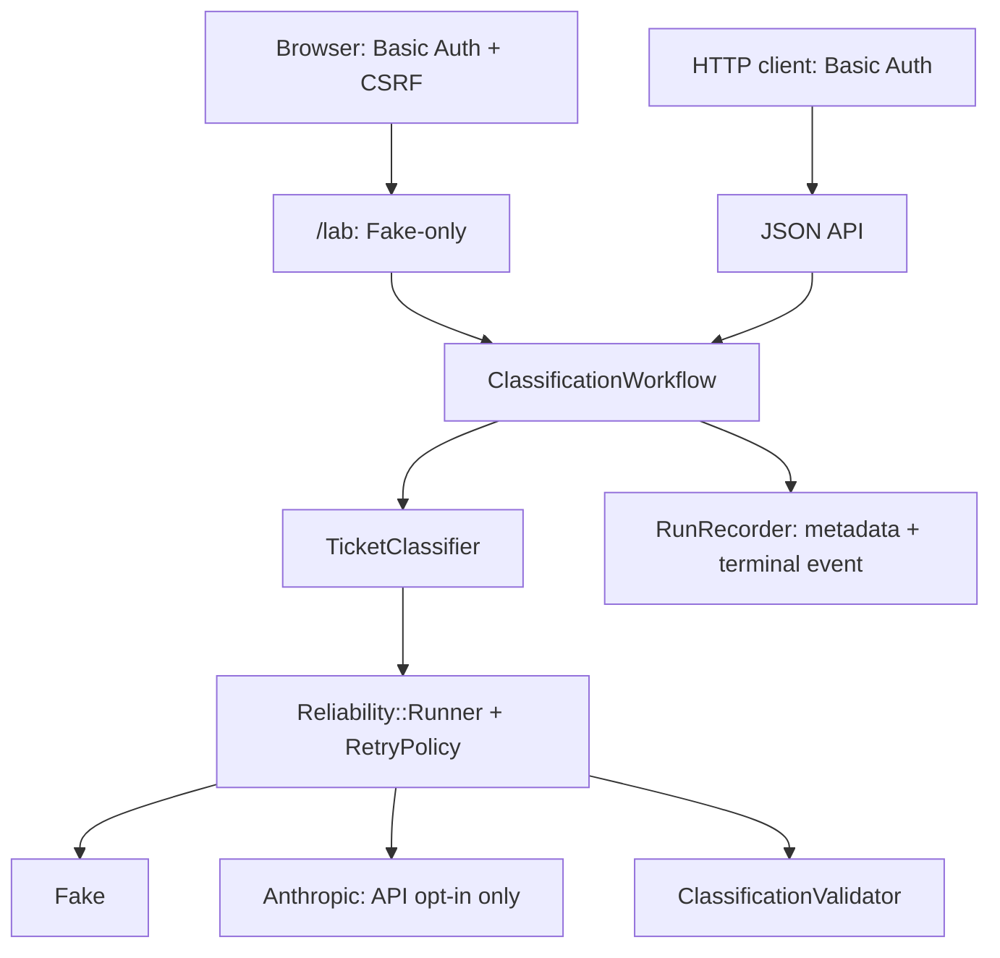

# Rails AI Reliability Lab

A reproducible Rails engineering lab demonstrating safer LLM integrations through
bounded retries, deadline management, typed failures, strict output validation and
privacy-conscious observability. **Synthetic engineering demonstration, for local
use only.** No production deployment, customer usage or model accuracy is claimed.


[Mobile capture](docs/images/dashboard-mobile.png) (390 px wide; history continues
below the crop). Captures show the real rendered interface with tokens removed;
latencies are samples, not benchmarks. [Three-minute walkthrough](docs/DEMO_GUIDE.md).

## What it demonstrates

- Eight deterministic Fake scenarios, including HTTP 429/503 simulation,
  Retry-After handling, bounded backoff and at most three attempts.
- Eight-second per-attempt and 25-second overall cooperative deadlines;
  typed errors and independent strict JSON schema validation.
- Optional guarded Anthropic SDK with internal retries disabled;
  the interactive dashboard always stays Fake-only.
- Metadata-only PostgreSQL records, Rails 8.1 structured terminal events and
  authenticated recent Fake history.
- Basic Auth, browser CSRF verification and escaped output; reproducible CI
  without API keys, using WebMock and virtual time.

## Architecture



[Detailed architecture and trust boundaries](docs/ARCHITECTURE.md) ·
[Engineering decisions](docs/DECISIONS.md).

## Stack

Ruby **4.0.6**, Bundler **4.0.16**, Rails **8.1.4**, PostgreSQL **17**;
Anthropic **1.80.0**, pg **1.7.0**, RSpec Rails **8.0.4**, FactoryBot Rails
**6.5.1**, WebMock **3.34.0**, RuboCop **1.92.0**, Brakeman **8.1.0**.
Hotwire uses Turbo Rails **2.0.23**, Stimulus Rails **1.3.4**, Importmap Rails
**2.2.3** and Tailwind CSS Rails **4.6.0**. See [Gemfile.lock](Gemfile.lock).
The current form uses standard HTML with Turbo disabled; no custom Stimulus
controller is necessary.

## Quick start — Ubuntu

Prerequisites: existing rbenv (or equivalent) Ruby 4.0.6, Bundler 4.0.16,
Docker with Compose and normal daemon access, GCC/build-essential, OpenSSL,
readline, zlib, libyaml, libffi and libpq development headers, and Git.
No Node package manager is needed. Do not change the global Ruby version.

```bash
git clone https://github.com/AndriiVal/rails-ai-reliability-lab.git
cd rails-ai-reliability-lab
rbenv versions
rbenv local 4.0.6
ruby -v
which ruby
gem -v
gem install bundler -v 4.0.16
bundle -v
bundle config set --local path vendor/bundle
bundle install
cp .env.example .env
```

Edit `.env` with dedicated local DB credentials and your Basic Auth username and
password. Keep it private. The example DB password is for local development only.
Compose reads `.env`; host-run Rails does **not** load it automatically.
The example uses shell-compatible assignments: only source your own reviewed
file, quoting values containing spaces or shell metacharacters.

```bash
set -a
. ./.env
set +a
docker compose config --quiet
docker compose up -d --wait db
bin/rails db:prepare
RAILS_ENV=test bin/rails db:prepare
bin/dev
```

Open <http://127.0.0.1:3000/lab> and enter the configured credentials.
<http://127.0.0.1:3000/up> is public. Rails binds to loopback via `bin/dev`.
For CSS live updates, run `bin/rails tailwindcss:watch` in another terminal.
`bin/dev` builds CSS before starting Rails and installs no global process manager.

Compose runs PostgreSQL only, at **127.0.0.1:5433**, with a dedicated named
volume. Rails runs on the host. The pinned image targets Ubuntu x86_64.
Do not use the host PostgreSQL service or run `docker compose down -v`.
Changing credentials after volume initialization requires matching DB role changes;
editing `.env` alone does not update stored PostgreSQL passwords.

## Try the API

With the same privately exported Basic Auth variables and Rails running:

```bash
curl --user "$BASIC_AUTH_USERNAME:$BASIC_AUTH_PASSWORD" \
  --header 'Content-Type: application/json' \
  --data '{"ticket_text":"I was charged twice for my synthetic subscription.","scenario":"success"}' \
  http://127.0.0.1:3000/api/v1/classifications
```

Default expected HTTP status / total attempts (including the first call):

- `success`: **200 / 1**
- `rate_limit_then_success`: **200 / 2**
- `server_error_then_success`: **200 / 3**
- `always_rate_limited`: **429 / 3**
- `timeout`: **504 / 3**
- `malformed_json`: **502 / 1**
- `schema_violation`: **502 / 1**
- `auth_error`: **502 / 1**

Deadlines/configuration can terminate earlier. These are synthetic outcomes,
not model measurements. Local retries incur real waits; the 429 recovery requires
at least one second of waiting. [API contract](docs/API.md) ·
[Timing policy](docs/FAILURE_SCENARIOS.md) · [Executed evidence](docs/VERIFICATION.md).

## Verify

After exporting the reviewed environment and preparing the test database:

```bash
bundle exec rspec
bin/rubocop
bin/brakeman --quiet --no-pager --exit-on-warn --exit-on-error
bin/ci
git diff --check
```

`bin/ci` checks dependencies, prepares the test DB, checks Zeitwerk, compiles assets,
runs RSpec, RuboCop and Brakeman. GitHub Actions uses the same gate with PostgreSQL
17 and dummy credentials. Current results and reproducibility limits are recorded
in [verification](docs/VERIFICATION.md) and [release readiness](docs/RELEASE_READINESS.md).
WebMock forbids unmocked HTTP. Brakeman is code scanning, not a dependency advisory audit.
After development asset precompilation, use `bin/rails assets:clobber` before asset editing.

## Privacy and limits

Use synthetic input on localhost only. Basic Auth is a local demonstration gate;
there is no public traffic throttling, billing quota or production hosting approval.
Only bounded scalar metadata is recorded, never tickets, prompts or completions.
The latest ten Fake records are private. [Dashboard and manual retention](docs/DASHBOARD.md).

[Anthropic opt-in](docs/ANTHROPIC_SETUP.md) is separate and disabled by default.
No live Anthropic test was performed. Cooperative timeouts cannot forcibly stop
arbitrary blocking Ruby; retries cannot guarantee exactly-once billing. Final-success
tokens exclude failed attempts. Terminal event delivery is best effort, without a
transactional outbox or background recovery. Metadata retention is manual.

[Simulated engineering audit](docs/AUDIT_REPORT.md) · [Security](docs/SECURITY.md) ·
[Specification](SPEC.md). This is source-code review readiness, not production certification.

MIT License, copyright 2026 Andrii Valchuk. See [LICENSE](LICENSE).
