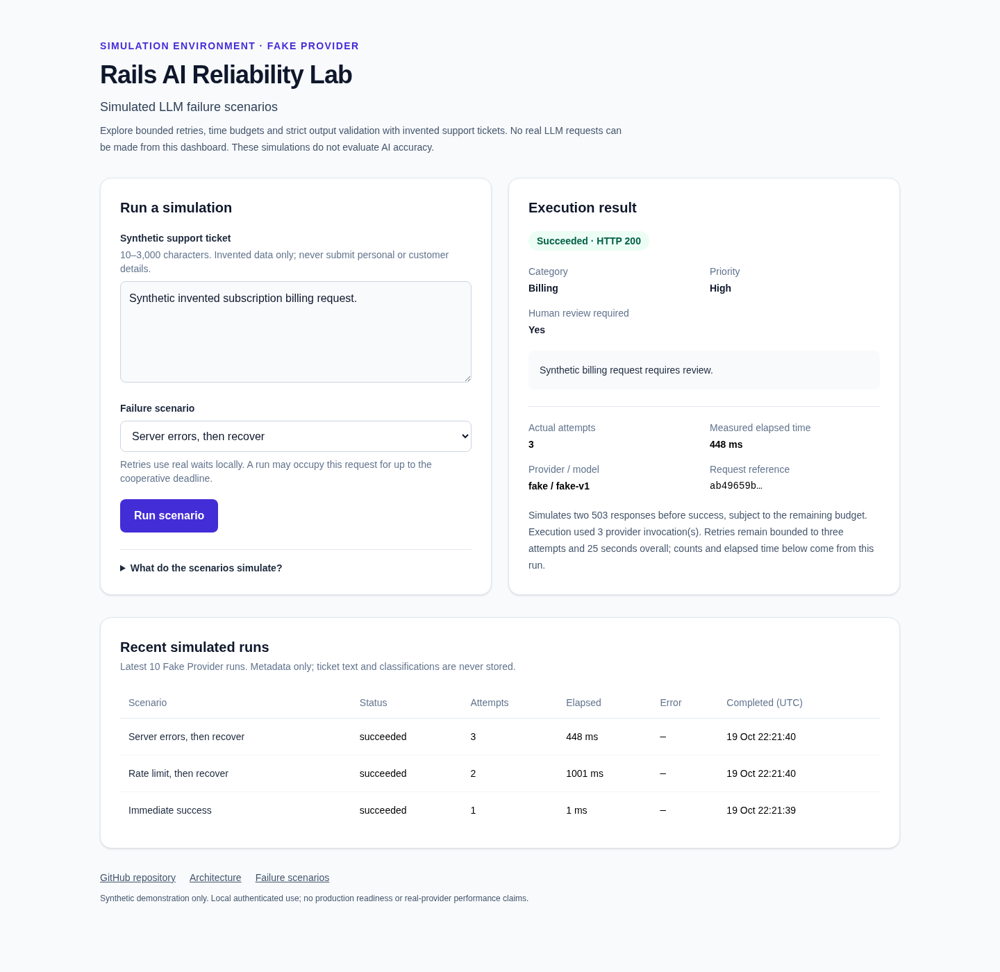

# Rails AI Reliability Lab

A Ruby/Rails engineering laboratory demonstrating reliable LLM integrations.
The current release provides an interactive private simulation dashboard, a public health check,
and a stateless ticket classification API with a deterministic Fake Provider.
**No real LLM requests occur by default.** A bounded reliability runner supports
eight synthetic failure scenarios. An optional Anthropic adapter requires explicit
server opt-in. Accepted runs record metadata only in local PostgreSQL and emit
allowlisted Rails events. The dashboard is always Fake-only, even under real
provider configuration.

Ruby **4.0.6**, Rails **8.1.4**, PostgreSQL **17**, Hotwire (Turbo/Stimulus),
importmap, Tailwind CSS, RSpec, FactoryBot, WebMock, RuboCop and Brakeman.

## Ubuntu setup

Prerequisites: existing rbenv (or equivalent) Ruby 4.0.6, Bundler 4.0.16,
Docker with Compose and normal daemon access, GCC/build-essential, OpenSSL,
readline, zlib, libyaml, libffi and libpq development headers, and Git.
No Node package manager is needed. Do not change the global Ruby version.

```bash
rbenv versions
rbenv local 4.0.6
ruby -v
which ruby
gem -v
bundle -v
bundle config set --local path vendor/bundle
bundle install
cp .env.example .env
```

Edit `.env` with dedicated local DB credentials and your Basic Auth username and
password. Keep it private. The example DB password is for local development only.
Compose reads `.env`; host-run Rails does **not** load it automatically.
The example uses shell-compatible assignments: only source your own reviewed
file, quoting values containing spaces or shell metacharacters.

```bash
set -a
. ./.env
set +a
docker compose config --quiet
docker compose up -d --wait db
bin/rails db:prepare
RAILS_ENV=test bin/rails db:prepare
bin/dev
```

Open <http://127.0.0.1:3000/lab> and enter the configured credentials.
<http://127.0.0.1:3000/up> is public. Rails binds to loopback via `bin/dev`.
For CSS live updates, run `bin/rails tailwindcss:watch` in another terminal.
`bin/dev` builds CSS before starting Rails and installs no global process manager.

Compose runs PostgreSQL only, at **127.0.0.1:5433**, with a dedicated named
volume. Rails runs on the host. The pinned image targets Ubuntu x86_64.
Do not use the host PostgreSQL service or run `docker compose down -v`.
Changing credentials after volume initialization requires matching DB role changes;
editing `.env` alone does not update stored PostgreSQL passwords.

## Checks

Use the same exported `.env` variables as above:

```bash
bin/rails assets:precompile
RAILS_ENV=test bundle exec rspec
bin/rubocop
bin/brakeman
bin/ci
git diff --check
```

`bin/ci` sets test mode, checks dependencies, prepares the test database,
checks Zeitwerk, compiles assets, runs RSpec, RuboCop and Brakeman. GitHub
Actions runs the same command with PostgreSQL 17 and dummy credentials.
Zero RSpec examples fail. WebMock blocks all unmocked HTTP.
After precompiling in development, run `bin/rails assets:clobber` before editing
assets so Rails serves new versions. Tests require the dedicated PostgreSQL DB.
Brakeman uses the locked version without a network freshness check.

## Security and scope

Missing, blank or incorrect Basic Auth credentials return 401. Keep the lab local;
Basic Auth does not encrypt credentials. CSRF protection remains enabled.
`LLM_PROVIDER=fake` and `ENABLE_REAL_LLM=false` are defaults. Only explicit
`true` (case-insensitive, trimmed) enables the future configuration flag;
real usage also requires a nonblank personal key and an exact allowlisted model.
Use synthetic data only; no production data or deployments. Keep keys private.
See [optional Anthropic setup](docs/ANTHROPIC_SETUP.md) for the locked SDK, guards,
timeout limits and separately authorized one-attempt manual smoke instructions.
No live Anthropic request was made during implementation.

See [architecture](docs/ARCHITECTURE.md), [decisions](docs/DECISIONS.md),
[security](docs/SECURITY.md), and the broader [specification](SPEC.md).

MIT License, copyright 2026 Andrii Valchuk. See [LICENSE](LICENSE).

## Classification API

See [API usage](docs/API.md) for curl examples, exact input/output constraints,
supported synthetic scenarios, status codes and privacy behavior.

```bash
curl --user "$BASIC_AUTH_USERNAME:$BASIC_AUTH_PASSWORD" \
  --header 'Content-Type: application/json' \
  --data '{"ticket_text":"I was charged twice for my synthetic subscription.","scenario":"success"}' \
  http://127.0.0.1:3000/api/v1/classifications
```

All eight [failure scenarios](docs/FAILURE_SCENARIOS.md) are implemented. The runner
allows at most three total provider invocations, an 8-second per-attempt budget
and a 25-second overall deadline. It honors Retry-After and uses bounded backoff
with jitter. Only metadata is recorded. Tests use virtual time; localhost scenarios
with retries incur real waits. These cooperative budgets do not forcibly interrupt
Ruby code. SDK transport propagation is covered by mocked tests; live latency
and account access remain unverified. No public hosting is approved.

## Interactive dashboard and metadata

Open `/lab` after the normal database setup. Submit an invented ticket, choose
any of the eight scenarios and inspect the classification/error, actual attempts
and measured latency. It works without JavaScript. Basic Auth and browser CSRF
verification are both required; the API remains independently available to curl.

The latest ten Fake-only run records show metadata, never ticket text or summaries.
The dashboard cannot activate Anthropic. Accepted API runs share the same recorder
and correlate their public UUID with the metadata row/event. Invalid inputs and
disabled configuration are excluded from recording. There is no public history.

See [dashboard, screenshots and telemetry contract](docs/DASHBOARD.md) for the
schema, event allowlist, recording-failure behavior and manual 30-day retention
recommendation. No scheduled deletion, background worker or exporter is installed.


