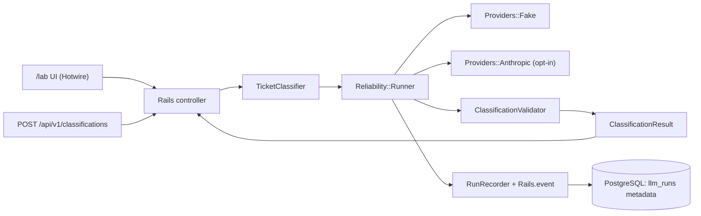

# Rails AI Reliability Lab — Technical Specification

**Status:** Product design and roadmap. Only the Foundation is implemented; classification, provider adapters, reliability policies, telemetry and audit scenarios below are planned.
**Version:** 1.0 — 2026-10-19
**Repository:** `AndriiVal/rails-ai-reliability-lab`
**Owner:** Andrii Valchuk
**Target platform:** Ruby **4.0.6**, Ruby on Rails **8.1.4**, PostgreSQL
**Audience:** Rails engineers, technical reviewers, potential SaaS clients
**Primary purpose:** A reproducible, privacy-conscious **portfolio demonstration** of resilient LLM integration patterns. **Not** a production-ready customer support platform.

---

## Executive summary

Build a compact Rails monolith that classifies **synthetic support tickets** using a deterministic Fake LLM Provider, with an optional real Anthropic adapter. Users can simulate external API failures and see what the reliability layer does: bounded retry/backoff, per-attempt timeout, overall deadline, structured-output validation, safe metadata collection, and clear failure responses.

The project must demonstrate engineering judgment, not merely an LLM API call. A reviewer should be able to clone it, start PostgreSQL, run tests **without any API key**, trigger sample failures, view attempt counts, and read a short sample audit report. No employer/client source code, architecture, credentials, or proprietary data may be used.

### Success definition

- Reproducible Fake Provider demo and documented quick start.
- `POST /api/v1/classifications` returns validated classification or documented structured error.
- Six or more deterministic failure/success scenarios, visible in the demo UI.
- Exactly one effective retry layer, predictable attempt count, strict time budgets.
- No ticket text, completions, passwords, or API keys persisted to DB or application event payloads.
- RSpec tests, RuboCop, Brakeman and GitHub Actions pass on Ruby 4.0.x and Rails 8.1.x.
- Local-only operation; no automatic deployments.
- At least five **simulated** audit findings clearly marked as examples, never client results.

### Hard constraints

| Decision | Requirement |
| --- | --- |
| Ruby | `4.0.6` pinned in `.ruby-version` and Gemfile |
| Rails | `8.1.4` locked within `~> 8.1.0`; no silent upgrades |
| DB | PostgreSQL; primary metadata storage only |
| UI | Rails views, Turbo, Stimulus, Tailwind; keep JS small |
| Testing | RSpec, FactoryBot, WebMock, deterministic fake clock/sleeper |
| LLM | Fake Provider by default; Anthropic Ruby SDK behind explicit flag |
| Hosting | Local only in MVP; public deployments explicitly out of scope |
| Confidentiality | Completely independent code and synthetic content |
| Budget | Target ~20–25 human-supervised engineering hours; stop scope creep |

**Dependency compatibility gate:** Rails 8.1 supports Ruby 3.2+ and the Anthropic Ruby SDK declares Ruby >= 3.2; this is *not* proof that every gem works on Ruby 4.0. Verify the selected versions of `rspec-rails`, `factory_bot_rails`, `webmock`, `tailwindcss-rails`, `pg`, native extensions and any lint/security tools by running `bundle install`, `bin/rails zeitwerk:check` and the tests on Ruby 4.0. Do not fabricate version compatibility. If any required dependency is incompatible, document the blocker and propose a minimal alternative while preserving Ruby 4.0/Rails 8.1 constraints.

## Scope and user stories

### Included in MVP (P0)

1. Server-rendered demo page `/lab` with a **synthetic** sample ticket and a scenario selector.
2. JSON classification endpoint (same core service as UI).
3. Classification schema: category, priority, summary, human review flag.
4. `Providers::Fake` with controlled success/error sequences.
5. `Providers::Anthropic` for opt-in manual experiments only.
6. `Reliability::Runner`: typed error handling, retry decision, deadline and timeouts.
7. Separate `ClassificationValidator` at the application trust boundary.
8. A request-metadata DB record and Rails 8.1 structured events.
9. RSpec regression tests, static analysis, CI without real API calls.
10. Small `AUDIT_REPORT.md` with simulated findings, safety section, setup docs.

### Explicitly excluded (P1/P2, not MVP)

- OpenAI/other provider adapters, RAG, embeddings, vector DB, MCP, multi-agent orchestration.
- Background queue/workers, streaming, WebSockets, cron, distributed tracing infrastructure.
- User accounts, organizations, billing, uploads, multi-tenant SaaS, OAuth, real support ticket integration.
- Public hosting or unattended use of an API key; automated real-provider CI tests.
- Full load testing, circuit breaker across processes, sophisticated cost analytics.
- LLM evaluations requiring subjective model-scored accuracy; only schema/reliability tests are P0.

### Acceptance-oriented user stories

- As a reviewer, I can run a fake scenario without an Anthropic account.
- As an engineer, I can see *why* an error is retryable or terminal, and how many attempts occurred.
- As an engineer, I can execute all tests and see the same deterministic outcomes on repeated runs.
- As a reviewer, I can inspect safe metadata without finding stored message bodies or secrets.
- As an owner, I can optionally use my API key locally to verify one real structured response.

## System boundaries and sequence



The HTTP controller never calls an SDK directly. Business logic never handles SDK-specific exceptions directly. Only provider adapters know SDK-specific response types. UI and API share the same orchestration service.

### Components and responsibilities

| Component | Owns | Must NOT own |
| --- | --- | --- |
| `TicketClassifier` | Prompt contract, classification orchestration, input limits | HTTP retries, Active Record queries |
| `Providers::Fake` | Deterministic fake response/error stream and usage | Network calls, sleeps, environment secrets |
| `Providers::Anthropic` | Claude SDK calls and exception translation | Nested retries, rendering, raw logging |
| `Reliability::Runner` | Retry policy, deadlines, normalized outcomes, attempt tracking | Prompt templates, DB schema |
| `ClassificationValidator` | Strict application-level schema checks | Provider selection, I/O |
| `RunRecorder` | Metadata-only persistence and events | Raw prompts/responses |
| `LabController` | Scenario selection and rendering | Business logic, direct SDK calls |
| `Api::V1::ClassificationsController` | Input validation and HTTP status mapping | Retry policy |

### Provider contract (pseudocode)

```ruby
# Illustrative interfaces, not code to copy blindly.
ProviderResponse = Data.define(:body, :model, :input_tokens, :output_tokens, :provider_request_id)
ProviderError    = Data.define(:code, :http_status, :retry_after_seconds, :message)

# provider.classify(ticket_text:, remaining_timeout_seconds:, scenario: nil)
# => ProviderResponse or raises typed errors with no sensitive data in the message
```

Choose one consistent error strategy (typed exceptions or Result objects) when implementing providers and document it. Do not mix generic `rescue StandardError` success paths with typed outcomes. Timeouts come from a passed-in budget rather than hard-coded SDK defaults.

## Classification contract

### Input

- UTF-8 text, strip leading/trailing whitespace.
- Required length: **10–3,000 Unicode characters** after normalization.
- No upload, URL fetching, tool execution, or arbitrary provider endpoint override.
- `scenario` is allowlisted **only when `LLM_PROVIDER=fake`**; ignored/rejected in real-provider mode (prefer 422).
- Client must not be able to select the real provider or model through untrusted input.

### Output schema (strict)

```json
{
  "category": "billing",
  "priority": "high",
  "summary": "Customer reports a duplicate charge and account access issue.",
  "requires_human_review": true
}
```

| Field | Type | Rule |
| --- | --- | --- |
| `category` | string | exactly one of `billing`, `technical`, `account`, `other` |
| `priority` | string | exactly one of `low`, `medium`, `high` |
| `summary` | string | nonblank, <= 240 chars, no HTML formatting requirement |
| `requires_human_review` | boolean | required, strictly `true`/`false` |

Reject unknown/extra fields, wrong types, missing fields, oversized summaries and malformed JSON. Do **not** coerce arbitrary strings (such as `"true"`) into booleans. A well-formed JSON object is not necessarily a valid classification. No use of model output as trusted instructions.

Anthropic structured output: use the currently supported `output_config: { format: ... }` API if available in the locked SDK version; then **independently validate** the normalized object using `ClassificationValidator`. Validate SDK semantics and exact method signatures during implementation; do not rely on provider-side schema enforcement alone.

### Prompt rules

- Fixed application-owned system instructions and versioned prompt (`prompt_version` constant).
- Treat ticket text strictly as untrusted classification data.
- Demand JSON only; never produce external actions, links, tools or shell commands.
- No secrets or model-specific privileged instructions from callers.
- Unit tests confirm that obvious instruction-injection text inside tickets is treated as data (schema integrity, not guaranteed semantic immunity).

## Public API (local development only)

### `POST /api/v1/classifications`

**Authentication:** HTTP Basic authentication is required for *all* app routes including `/lab` in the MVP; credentials come only from local environment or encrypted Rails credentials. Use TLS if ever deployed (deployment out of scope). Never hard-code credentials or print them. This is a single-owner technical lab, not a full auth system. Use Rails' standard Basic Auth helper rather than implementing password comparisons manually.

**Content-Type:** `application/json`

**Request** (Fake Provider mode):

```json
{
  "ticket_text": "I was charged twice for my subscription and cannot sign in.",
  "scenario": "rate_limit_then_success"
}
```

`scenario` is optional, defaults to `success` in fake mode. In real mode, `scenario` is prohibited. No client-supplied `provider`, `model`, `api_key`, or URL fields.

**200 success:**

```json
{
  "request_id": "00000000-0000-4000-8000-000000000001",
  "result": {
    "category": "billing",
    "priority": "high",
    "summary": "Customer reports a duplicate charge and sign-in problem.",
    "requires_human_review": true
  },
  "meta": {
    "provider": "fake",
    "model": "fake-v1",
    "attempt_count": 2,
    "latency_ms": 1012,
    "input_tokens": null,
    "output_tokens": null
  }
}
```

**Error response:**

```json
{
  "request_id": "00000000-0000-4000-8000-000000000002",
  "error": {
    "code": "rate_limited",
    "message": "The upstream provider is temporarily rate limited.",
    "retryable": true
  },
  "meta": { "provider": "fake", "attempt_count": 3 }
}
```

Request IDs are generated per request; examples above are schematic. Returned summary may reflect the submitted text; only **synthetic input is allowed for demos**. Neither input nor output bodies are saved in the metadata table.

### HTTP status mapping

| Situation | HTTP | `error.code` | Retry client automatically? |
| --- | ---: | --- | --- |
| Invalid or missing input/scenario | 422 | `invalid_input` | No |
| Missing/incorrect app credentials | 401 | `unauthorized` | No |
| Live provider not enabled/configured | 503 | `provider_disabled` | No |
| Upstream 401/403 credentials/permission failure | 502 | `provider_auth_error` | No |
| Upstream 429 after safe budget exhaustion | 429 | `rate_limited` | Conditional; obey `Retry-After` |
| Upstream 408/5xx after retry exhaustion | 503 | `provider_unavailable` | Conditional |
| Network/per-attempt or overall timeout | 504 | `provider_timeout` | Conditional |
| Malformed or schema-invalid provider result | 502 | `invalid_provider_output` | No |
| Unexpected server bug | 500 | `internal_error` | No until investigated |

No upstream provider stack traces, SDK exception details, API keys or ticket text in error JSON.

### Other routes

- `GET /lab`: private server-rendered scenario playground.
- `POST /lab/run`: same Rails service as API; Rails CSRF protection must remain enabled; use Turbo-compatible response or regular redirect/render.
- `GET /up`: Rails built-in health check if generated (never disclose secrets or database contents; check exact generated route).
- **Not in MVP:** public run history API, user management, deletion endpoint, arbitrary model selection.

## Deterministic failure scenarios

The `Fake` provider consumes a test-controlled **sequence of attempt outcomes**. An injected Clock/Sleeper lets RSpec test retries without wall-clock sleeps. The UI labels synthetic results as simulated.

| ID | Sequence | Expected attempts | Final result |
| --- | --- | ---: | --- |
| `success` | valid JSON | 1 | 200 success |
| `rate_limit_then_success` | 429 with 1s `Retry-After`, then success | 2 | 200 success |
| `server_error_then_success` | 503, 503, success | 3 | 200 success |
| `always_rate_limited` | 429, 429, 429 | 3 or fewer if deadline insufficient | 429 exhausted |
| `timeout` | network timeout every attempt | <= 3 and overall deadline respected | 504 |
| `malformed_json` | HTTP 200 + invalid JSON | 1 | 502 no retry |
| `schema_violation` | HTTP 200 + syntactically valid JSON but invalid enum/type | 1 | 502 no retry |
| `auth_error` | 401 upstream | 1 | 502 no retry |

All scenarios must be deterministic **at the decision level**; actual latency values may vary if real scheduling/sleep is used in the UI. Test virtual time separately. For a rate limit with `Retry-After` longer than the remaining overall deadline, **do not retry early**; terminate with a controlled rate-limit result and record why.

## Reliability policy (single source of truth)

### Defaults (configurable and tested)

| Setting | MVP default |
| --- | ---: |
| Maximum total attempts | 3 (initial call + at most 2 retries) |
| Per-attempt transport timeout | 8 seconds, bounded by remaining overall deadline |
| Overall request deadline | 25 seconds, measured with `Process.clock_gettime(CLOCK_MONOTONIC)` |
| Base backoff | 200 ms |
| Exponential backoff | multiplier 2 with jitter |
| Backoff cap | 2 seconds (non-header delays) |
| Retry-After | respect valid positive delta-seconds or HTTP-date; **never sleep less than requested** |

The configuration is a portfolio lab example, **not** a universal recommended production SLA. A 25-second synchronous endpoint can occupy web workers: do not publicly deploy this configuration without redesign/traffic controls.

### Retryable vs nonretryable

Retry (subject to budget): transient connection failures, transport timeouts, 408, 409, 429, and HTTP 5xx. Do not retry: 400/401/403/404, input validation failures, malformed or invalid-schema output, credential/configuration errors. Consider server-provider exception types and HTTP status before deciding. Never retry an unclassified `StandardError` blindly.

If a provider returns `Retry-After`, parse safely and obey it. If a valid header would exceed remaining time, **fail fast** rather than violating the provider's minimum delay. Invalid header falls back to exponential backoff. Backoff jitter and clock/sleep must be injectible for deterministic tests.

### Prevent hidden SDK retries

Configure `Anthropic::Client.new(max_retries: 0, timeout: <remaining capped seconds>)` or the SDK-version-correct equivalent. Verify actual method signatures before coding. Application `Reliability::Runner` owns **all retry decisions**, and `attempt_count` measures real HTTP request attempts, not high-level SDK calls that may internally fan out.

Timeout budget is passed to the actual HTTP transport. **Do not use `Timeout.timeout` around arbitrary code/network calls** as an imitation of a robust deadline. Do not promise exact-once provider billing: retries may incur additional API usage, especially after ambiguous transport failures.

### Concurrency, cost and future public use

For MVP, run synchronously only under the local/demo access controls. Set an optional max input length, max output tokens, reasonable per-call timeout and real API opt-in. No real provider in CI. Before public deployment, introduce request rate limits, traffic quotas, enforced API budget and background processing as a separate project milestone.

## Data design and observability

### PostgreSQL table: `llm_runs`

Persist **metadata only**, no prompts, responses, summaries, customer identifiers, user email, raw headers, or raw provider exceptions.

| Field | Suggested type | Requirements |
| --- | --- | --- |
| `id` | bigint PK | Internal ID |
| `request_id` | string/uuid | unique, opaque, indexed, generated server-side |
| `provider` | string | `fake` or `anthropic` |
| `model_name` | string | allowlisted/configured model only |
| `scenario` | string nullable | fake scenario ID only |
| `status` | string | `started`, `succeeded`, `failed` |
| `attempt_count` | integer | >= 0 |
| `latency_ms` | integer nullable | >= 0; measured with monotonic clock |
| `input_tokens` | integer nullable | >= 0; true provider usage when available |
| `output_tokens` | integer nullable | >= 0 |
| `error_code` | string nullable | controlled enum of known errors |
| `provider_request_id` | string nullable | safe opaque support identifier |
| `completed_at` | timestamp nullable | set on terminal outcome |
| `created_at`, `updated_at` | timestamps | standard |

Indices: unique on `request_id`, normal composite on `(provider, created_at)` for local dashboard statistics. `status` transitions are `started -> succeeded|failed` only. A framework crash may leave a `started` row, which is acceptable and documented for this synchronous local demo; no recovery worker is required in MVP.

Cost calculation is optional P1; do not present token counts as exact USD costs without a model-price table and versioned pricing assumptions.

### Rails 8.1 Structured Event Reporter

Use `Rails.event.notify` with allowlisted **metadata only**, for example:

```ruby
Rails.event.notify("llm.classification.finished", {
  request_id: run.request_id,
  provider: run.provider,
  outcome: run.status,
  attempt_count: run.attempt_count,
  latency_ms: run.latency_ms,
  error_code: run.error_code
})
```

Define a simple subscriber whose output can be tested. Do not include `ticket_text`, output `summary`, API token, request headers or user identifiers. Ensure Rails parameter filtering covers secret parameters. Avoid logging request bodies on error; audit Rails/SDK exception logging for accidental leakage. Tests must confirm absence of provided sentinel secrets in records and events.

## Security and privacy controls

1. **Local-first, authenticated**: require env-provided single-owner HTTP Basic credentials on `/lab` and all API actions. Public deployment is forbidden until additional review; if ever deployed, TLS is mandatory.
2. **Provider opt-in**: `LLM_PROVIDER=fake` and `ENABLE_REAL_LLM=false` by default. A real call requires both `LLM_PROVIDER=anthropic` and `ENABLE_REAL_LLM=true`, plus configured `ANTHROPIC_API_KEY` and a specific allowlisted model.
3. **Synthetic samples only**: never commit, send, or store data belonging to employers, users, patients, or any real client.
4. **Secrets**: `.env.example` has placeholders only. `.env`, credentials keys, outputs and test artifacts with secrets are gitignored; secret scanning before a public release.
5. **Input bounds**: 10–3,000 characters, JSON body size limit, no arbitrary URLs or tool calling.
6. **Output distrust**: schema-validate; render HTML-escaped by default; no `html_safe` on model content.
7. **CSRF**: enabled for session/UI form. API uses the same Basic Auth gate, no cookies needed for stateless clients; explicitly test API CSRF configuration and choose correct Rails controller inheritance. Do not globally disable CSRF.
8. **No outbound calls in CI**: stub the provider; tests must fail on unmocked external requests.
9. **No production assertions**: README and audit report label all measurements as demonstration/synthetic.
10. **Data retention**: choose simple local-only deletion/rotation policy for metadata (e.g., manual cleanup). No personally sensitive content ever stored.

### Threat model (MVP)

| Threat | Control |
| --- | --- |
| Unauthorized use of real paid LLM | Basic Auth + opt-in flags + no public hosting |
| Prompt injection from ticket text | Strict separation of data and system instructions; schema validation; no tool calls |
| API token leaked via logs | Filtering, minimal event payloads, secrets tests |
| Unbounded provider retries | One retry layer and request deadline |
| Unauthorized provider/model chosen by client | Fixed server configuration |
| Raw PII stored in DB | Metadata-only schema |
| Future public demo abused | **Out of scope**; security gate before deployment |
| Malicious user-supplied URLs | No URL-fetch feature |

## UX: demonstration dashboard

`GET /lab`:

- Clear heading: **"LLM Reliability Lab — Simulated Failure Scenarios"**.
- Input prepopulated with a synthetic support request (no real user/customer data).
- Scenario dropdown (Fake Provider only): success, rate limit then success, server error then success, always rate limited, timeout, malformed JSON, schema violation, auth error.
- One **Run scenario** action (CSRF-protected); results show success/error code, attempt count, approximate elapsed time, provider mode, redacted request ID.
- Plain-language explanation of *why* retries happened or stopped.
- Link to `docs/AUDIT_REPORT.md` and source; no claim of customer production deployment.
- Stimulus for progressive interaction only; must function with standard form submission if JS is disabled.
- Minimal accessible labels, status messages, keyboard navigation, mobile layout.

Do not add login, chats, file uploads or charts during the first release. Optional copyable JSON view is acceptable if it does not expose secrets.

## Repo structure (target, not mandatory scaffolding)

```text
rails-ai-reliability-lab/
├── .github/workflows/ci.yml
├── .ruby-version
├── .env.example
├── Gemfile / Gemfile.lock
├── README.md
├── SPEC.md
├── compose.yml                     # PostgreSQL only; Ruby runs on Ubuntu host
├── app/
│   ├── controllers/
│   │   ├── lab_controller.rb
│   │   └── api/v1/classifications_controller.rb
│   ├── models/llm_run.rb
│   ├── services/
│   │   ├── ticket_classifier.rb
│   │   ├── classification_validator.rb
│   │   ├── providers/fake.rb
│   │   ├── providers/anthropic.rb
│   │   └── reliability/
│   │       ├── runner.rb
│   │       ├── retry_policy.rb
│   │       ├── error_classifier.rb
│   │       ├── clock.rb
│   │       └── run_recorder.rb
│   ├── javascript/controllers/lab_controller.js
│   └── views/lab/
├── config/
│   ├── routes.rb
│   └── initializers/llm_config.rb
├── db/migrate/
├── docs/
│   ├── ARCHITECTURE.md
│   ├── FAILURE_SCENARIOS.md
│   ├── AUDIT_REPORT.md
│   ├── SECURITY.md
│   └── DECISIONS.md
└── spec/
    ├── requests/
    ├── models/
    ├── services/
    ├── factories/
    └── support/
```

**YAGNI rule:** create files only when implementation actually needs them. Names are illustrative; Rails autoloading/namespace conventions take precedence. Do not generate unused abstractions.

## Test strategy (RSpec)

### Test policy

- Test behavior, not exact private implementation.
- Unit tests use injected fake clock/sleeper and Fake Provider; no real waits or HTTP.
- WebMock denies external network connections in test, except local DB is not HTTP.
- Requests specs cover authentication, payload validation, status mapping and JSON shape.
- Model specs check metadata constraints and that user-supplied text is **not** persisted.
- Feature/system tests for `/lab` can be one focused smoke test; avoid flaky browser stack in CI until necessary.
- One simulated scenario must prove total attempts include the initial request.

### Critical test cases / minimum coverage

| ID | Expected assertion |
| --- | --- |
| T01 | Valid synthetic input and fake success -> 200, schema matches |
| T02 | Input < 10 or > 3,000 chars -> 422, no provider attempt |
| T03 | Unsupported scenario -> 422, no provider attempt |
| T04 | No/wrong Basic Auth -> 401, no provider attempt |
| T05 | 429 then success -> exactly 2 attempts and respects `Retry-After` |
| T06 | 503, 503, success -> exactly 3 attempts |
| T07 | Three repeated 429 responses -> terminal 429, <= 3 attempts |
| T08 | HTTP 401 upstream -> terminal mapped 502, 1 attempt |
| T09 | Malformed provider JSON -> terminal 502, 1 attempt |
| T10 | Wrong enum, missing field, extra field, string boolean -> rejected |
| T11 | Connection timeout -> <=3 attempts; obeys overall deadline |
| T12 | `Retry-After` > remaining time -> no premature retry |
| T13 | Unexpected Ruby exception does not become an infinite retry |
| T14 | `LLM_PROVIDER=anthropic` but no opt-in -> 503 before SDK call |
| T15 | Real SDK constructed with `max_retries: 0` or equivalent (mock assertion) |
| T16 | Run record stores no source ticket, model completion, API key, prompt text |
| T17 | Structured events contain only allowlisted metadata |
| T18 | Provider configuration cannot be controlled via JSON body |
| T19 | HTML summary is escaped when displayed, no script execution |
| T20 | WebMock blocks unmocked HTTP in test; Fake Provider makes no calls |
| T21 | CI uses Ruby 4.0.x, Rails 8.1.x, PostgreSQL; all checks pass |
| T22 | A real-provider smoke test is excluded from ordinary CI |

**Baseline:** all 22 classes of checks should have executable examples, with multiple spec cases for schema edge conditions. No arbitrary coverage-percent target in MVP; focus on critical paths and deterministic failures.

## Continuous integration and local quality gates

### Actions triggers

- Pull requests, pushes to `main` (or `master`; choose once at repo creation), and manual workflow dispatch.
- Read-only GitHub token: `permissions: contents: read`.
- No access to Anthropic API keys; no live-provider integration in CI.
- Concurrency cancellation for superseded pull request runs.

### Required jobs/commands

1. Ruby 4.0.x via `ruby/setup-ruby`, with `bundler-cache: true`.
2. PostgreSQL service, with non-production dummy credentials only.
3. `bin/rails db:prepare` in `RAILS_ENV=test`.
4. `bundle exec rspec`.
5. `bin/rails zeitwerk:check`.
6. `bin/rubocop` (or `bundle exec rubocop`), Brakeman (`bin/brakeman` or equivalent).
7. Optional Bundler audit/importmap audit if generated; do not add fragile tools without verification.

Rails 8.1 also supports `config/ci.rb` / `bin/ci`. If using it, **edit its generated test step from Minitest to RSpec** and make local and GitHub checks equivalent, rather than accidentally running only the default `bin/rails test`.

### Gate for merging

- Every mandatory job green; review of failure logs.
- No new runtime secret or private code in diff.
- A code review found no unresolved critical/high issues.
- Maintainer review before merging; no automatic deployments.

## Product roadmap

The following milestones distinguish implemented Foundation behavior from planned functionality.

### Milestone 1 — Foundation

**Scope:** fresh Rails 8.1 app running under Ruby 4.0.x, Postgres, Tailwind, Hotwire, RSpec, WebMock, FactoryBot, `.env.example`, `compose.yml` for Postgres, CI and initial docs. Configure authentication gate, fake defaults and `zeitwerk:check`.

**Acceptance:** `bundle install`, `bin/rails db:prepare`, `bundle exec rspec`, RuboCop, Brakeman, GitHub Actions all pass on pinned versions. App boots, `/lab` requires Basic Auth. No external calls or live-provider key needed.

### Milestone 2 — Fake classification core

**Scope:** classification schema/validator, Fake Provider, `TicketClassifier`, request endpoint, canonical result/error payloads, basic request tests.

**Acceptance:** 200 success, 401 unauthorized, 422 invalid input, 502 invalid fake output, all deterministic; no persistence of text. No Anthropic SDK calls.

### Milestone 3 — Reliability engine

**Scope:** `Reliability::Runner`, error taxonomy, attempt count, virtual clock/sleeper, retries, backoff, `Retry-After` and deadline management. All fault scenarios.

**Acceptance:** T05–T13 green; exact attempt counts; no nested retries; actual HTTP client timeouts budgeted; no unbounded sleeping or loops.

### Milestone 4 — Anthropic opt-in adapter

**Scope:** official SDK, server-side allowlisted model, current structured output API, normalized usage + request ID, disabled-by-default guard, manual smoke-test instructions.

**Acceptance:** tests mock all SDK/network calls and verify no SDK retries; fake CI still passes with no key. Opt-in manual real smoke succeeds **if** an authorized key and supported model are supplied; otherwise clearly marked unverified without blocking fake CI.

### Milestone 5 — Demo and safe telemetry

**Scope:** `/lab` UX, `llm_runs` metadata table and structured events, minimal recent results, accessible UI, no raw request bodies saved, safe HTML escaping.

**Acceptance:** eight scenarios selectable, attempt count and failure explanation visible, T16–T19 green; run records never contain ticket content or credentials.

### Milestone 6 — Showcase & release review

**Scope:** README, architecture docs, simulated audit report, limitations, dependency/security scan, one concise demo video/GIF if time permits.

**Acceptance:** a reviewer can clone, set local credentials, run app in fake mode and test all scenarios using documented commands. Documentation never claims real client work or verified production suitability.

### Stop/go milestones

- After Milestone 1: stop if Ruby 4.0/Rails 8.1 dependency installation fails; solve compatibility before feature coding.
- After Milestone 3: working fake-only demo is already useful; **publish the portfolio incrementally** if remaining work risks scope explosion.
- Before any real provider call: confirm API billing/quota, explicit opt-in and SDK retries disabled.
- Before public deployment: launch a *separate* security, authentication, traffic-limit and hosting review (not covered by MVP).

## Documentation requirements

### `README.md`

1. Value proposition and clearly labeled **simulated demo**.
2. Screenshot or lightweight animation, if available.
3. Stack and exact pinned versions.
4. Quick start for Ubuntu using Ruby 4.0, Rails 8.1 and Compose PostgreSQL.
5. `.env.example` and fake mode instructions.
6. Example `curl` with HTTP Basic Auth against localhost.
7. Scenario matrix and run commands.
8. How to run RSpec and `bin/ci`.
9. Privacy, security and limitations; opt-in Anthropic use.
10. Links to architecture and sample audit report.

### `docs/AUDIT_REPORT.md`

**MUST clearly start with:** "Simulated engineering audit of the Rails AI Reliability Lab. Not a client assessment. All failures and results are synthetic."

Five minimum findings: double retries, ignored 429 `Retry-After`, absent total deadline, unvalidated JSON, sensitive-text logging. For each: finding ID, reproduction steps, expected impact, fix, automated proof/test name, residual risk, severity rationale. Report honest pre-fix versus post-fix behavior: design illustrative pre-fix examples and mark as simulated, never fabricate captured production evidence.

### `docs/DECISIONS.md`

Concise ADRs: Rails monolith; sync vs job; single retry owner; no persisted raw text; Fake Provider default; one provider; real mode disabled; RSpec, not Minitest.

## Definition of Done — entire MVP

- [ ] Rails 8.1.x and Ruby 4.0.x versions verified and pinned.
- [ ] All required gems install and app boots on Ubuntu; documented build steps.
- [ ] Fake Provider runs without network/API credentials.
- [ ] Classification API matches success/error contracts.
- [ ] Strict schema validation rejects malformed and incorrect output.
- [ ] Retry attempts, `Retry-After` and deadlines work per spec.
- [ ] Anthropic adapter is opt-in; SDK retries disabled and mocked in CI.
- [ ] All request/auth/security and fault injection tests pass.
- [ ] Metadata/events contain no sensitive message contents or secrets.
- [ ] CI green for test, lint, Zeitwerk and Brakeman.
- [ ] `/lab` displays simulated scenario explanations and works on mobile.
- [ ] README / architecture / security / sample audit report accurately reflect real implementation.
- [ ] Final code review reports zero unresolved high/critical findings.
- [ ] Owner reviews PRs and manually merges; no production/customer access.

## Risks and open implementation decisions

| Risk / question | Decision or mitigation |
| --- | --- |
| Ruby 4.0 gem incompatibility | Explicit Milestone 1 compatibility gate; pin known-working gem versions |
| Rails 8.1 native CI defaults to Minitest | Replace with RSpec; verify actual generated `bin/ci` behavior |
| SDK helper/schema changes | Inspect installed Anthropic SDK docs and lockfile; adapter isolates version |
| Retry layering | Explicit `max_retries: 0` in SDK plus tests |
| Real provider usage cost | Flag off by default, no CI secrets, manual opt-in |
| Public app abused | Not hosted in MVP; later auth/rate limit/security milestone |
| LLM output can still be untrustworthy | Strict contract validation; never execute actions from text |
| Time estimate optimistic | Scope freeze and fake-only MVP fallback after Milestone 3 |
| Conflicts with employer IP or contract | Independent coding only; verify outside work/IP agreements |
| Rails 8.1 structured-event subscribers | Keep minimal subscriber; ensure payload sanitization in tests |

## Reference documentation

- Ruby 4.0 release: https://www.ruby-lang.org/en/news/2025/12/25/ruby-4-0-0-released/
- Rails 8.1 release notes: https://guides.rubyonrails.org/8_1_release_notes.html
- Rails 8.1 getting started / generated CI: https://guides.rubyonrails.org/v8.1/getting_started.html
- Rails Structured Event Reporter: https://api.rubyonrails.org/v8.1.1/classes/ActiveSupport/EventReporter.html
- Anthropic Ruby SDK installation, retries, timeouts: https://platform.claude.com/docs/en/cli-sdks-libraries/sdks/ruby
- Anthropic Ruby structured outputs helpers: https://github.com/anthropics/anthropic-sdk-ruby/blob/main/helpers.md
- RSpec Rails version policy: https://github.com/rspec/rspec-rails

---
